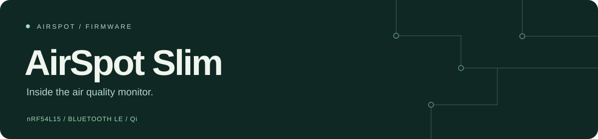

Firmware for the **AirSpot Slim** air quality monitor. It reads CO₂, temperature,
humidity and pressure, saves measurements on the device, and connects to the
AirSpot app over Bluetooth.

[Get started](docs/GETTING_STARTED.md) · [Hardware](docs/board/PRODUCTION_BOARD.md) · [BLE protocol](application/docs/protocol_commands.md) · [Test status](docs/STATUS.md)

> **Current work: 0.19.2 candidate.** The latest source is on `main`. It is still
> being tested on hardware and has not been released to customers.

## The board

| Part | What it does |
| :--- | :--- |
| Nordic **nRF54L15** | Runs the firmware and Bluetooth |
| Sensirion **STCC4** | Measures CO₂ |
| Sensirion **SHT40** | Measures temperature and humidity |
| ST **LPS22HH** | Measures pressure for CO₂ compensation |
| **AT25XE161D**, 2 MiB | Stores measurement history |
| Nordic **nPM1100** + Qi receiver | Battery power and wireless charging |

Built with **C, Zephyr and nRF Connect SDK v3.2.1**. The board configuration,
bootloader and dependencies are pinned in this repository.

## Build, flash, read the logs

On a configured development machine, from the repository root:

```sh
source scripts/airspot
airspot build
airspot check
airspot flash
airspot logs
```

**New checkout?** Start with the [setup guide](docs/GETTING_STARTED.md). You need
the Nordic toolchain and the product signing key; the private key is not in Git.
The current helpers are configured for the team's macOS toolchain installation.

`flash` checks the image, backs up device memory and preserves the current
settings partition. With more than one J-Link connected, select a probe with
`--serial SERIAL`. Nothing is flashed by `build` or `check`.

| Command | Use it to… |
| :--- | :--- |
| `airspot devices` | Find connected J-Link probes |
| `airspot build` | Build MCUboot and signed firmware |
| `airspot check` | Check signatures, memory layout and board configuration |
| `airspot flash` | Install over J-Link, with backup and readback verification |
| `airspot logs` | Stream device logs over RTT |
| `airspot reset` | Reboot the connected MCU |
| `airspot version` | Print the source version |

## What the firmware handles

- **Measurements:** continuous and single-shot sampling, sensor compensation,
  and explicit error reporting when a reading fails.
- **History:** readings stored in external flash and downloaded over Bluetooth.
- **Calibration:** manual correction, automatic calibration controls, and
  settling guidance after calibration is erased.
- **Recovery:** bounded sensor retries, watchdog supervision and retained fault
  records for diagnosis.
- **Updates:** signed Bluetooth OTA through MCUboot. A new image must pass
  startup checks and produce a valid sample before it confirms itself.

[Update and rollback details →](docs/OTA.md)

### Restart is not factory reset

These are the Slim behaviors in the current candidate. The Screen firmware is
maintained separately.

| Action | Result |
| :--- | :--- |
| **Restart device** | Reboots the MCU. Keeps settings, readings and calibration. |
| **Erase sensor calibration** | Clears learned calibration and manual correction, then starts settling guidance. Keeps saved readings and unrelated preferences. |
| **Factory reset** | Clears settings, readings, saved history pointers and calibration, then cuts power. Remove it from the charger first; press the button to wake it afterward. |

[Factory reset implementation and device test →](docs/SLIM_FACTORY_RESET_POWER_OFF.md)

## Finding your way around

```text
application/
  src/drivers/       Sensor, flash, battery, button and LED drivers
  src/services/      Sampling, Bluetooth, history, calibration and updates
  boards/            Slim board configuration
  boot_support/      MCUboot support for this board
  west.yml           Pinned SDK dependency manifest
scripts/             Build, programming and diagnostic tools
tests/               Host regression tests and hardware test fixtures
docs/                Hardware notes, protocol details and test records
```

| If you're working on… | Start here |
| :--- | :--- |
| Board wiring or a hardware fault | [Production board](docs/board/PRODUCTION_BOARD.md) |
| App communication | [BLE commands](application/docs/protocol_commands.md) |
| Firmware installation or signing | [OTA and wired installation](docs/OTA.md) |
| Sensor recovery | [Automatic recovery](docs/SLIM_AUTOMATIC_RECOVERY.md) |
| Calibration after a reset | [Settling guidance](docs/SLIM_SETTLING_GUIDANCE.md) |
| What has actually been tested | [Current status](docs/STATUS.md) |
| Earlier investigations | [Archive](docs/archive/README.md) |

## Before changing firmware

Run the host tests in the configured SDK environment:

```sh
/opt/nordic/ncs/toolchains/322ac893fe/bin/python3 -m unittest discover -s tests
```

Then run `airspot build` and `airspot check`. Changes to sensor timing, charging,
buttons or power need a real-device test too. Record the device, firmware version
and result so the next person knows what was checked.

Keep private signing keys and device backups out of commits. Old packages under
`releases/` are historical artifacts; check their hardware target and test notes
before using them.
